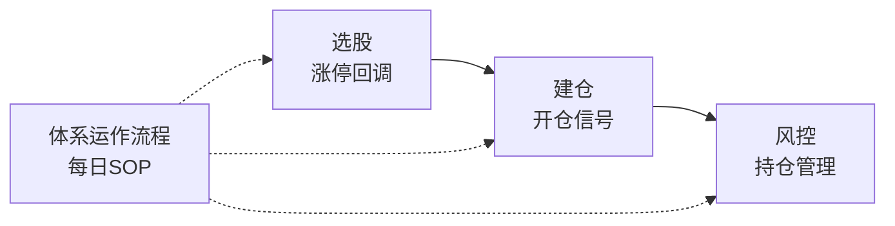

# 热门板块回调低吸体系

## 概述

基于**涨停启动→回调企稳→放量突破**的强势股第二波策略。核心理念：

- **只做涨停股**：涨停是资金关注度的第一道门槛，不在不涨停的股票里找机会
- **回调不破位**：涨停后回调但不跌破10日线，说明洗盘而非出货
- **放量确认**：回调后放量突破5日线，确认第二波启动

策略来源：[[笔记/交易策略/2026-06-16/小红书-热门板块回调低吸策略.md|小红书 - 热门板块回调低吸策略]]

## 体系架构



同日存在并且结构有效的红利网格 `sector_facts.json` 可复制为本体系的 `shared_sector_context.json`，仅作为全市场环境背景；候选行业仍由本体系独立计算专项热度。

| 文件 | 定位 |
|------|------|
| [[交易/交易体系/热门板块回调低吸体系/选股.md|选股]] | 近期涨停统计 → 回调均线确认 → 行业过滤 → 候选池 |
| `shared_sector_context.json` | 可选复制同日网格全市场板块环境事实，保留来源 |
| [[交易/交易体系/热门板块回调低吸体系/建仓.md|建仓]] | 放量突破均线检测 → `entry_signal.json` |
| [[交易/交易体系/热门板块回调低吸体系/风控.md|风控]] | 开盘信号 + 审慎标签 + MA5/MA10 + 固定止损 → `risk_signal.json` |
| [[交易/交易体系/热门板块回调低吸体系/体系运作流程.md|体系运作流程]] | 每日执行→复盘→生成计划 SOP |

## 账户

本体系通过 MNZH 模拟账户进行观察和验证：

| 账户 ID | 类型 | 说明 |
|---------|------|------|
| MNZH | 模拟账户 | 用于回放执行和策略验证，非实盘 |

## 成熟度

**观察体系。** 当前阶段以检验策略逻辑完整性为目标，不追求实际收益。所有执行均在模拟账户进行。

## 核心流程

```text
prepare_shared_sector_context（可选：复用同日网格板块环境事实）
    ↓
select_candidates（全市场候选筛选）
    ↓
sector_heat（候选行业专项热度事实）
    ↓
render --date <日期> --template sector_heat
    ↓
AI 判断热门行业 → 落过程资料「板块热度研判」
    ↓
select_candidates --industry 筛选 → hottest_industry_candidate.json
    ↓
entry_signal (建仓技术信号) → entry_signal.json
    ↓
risk_signal (持仓风险评估) → risk_signal.json + 状态快照
    ↓
AI 综合决策 → 交易计划（引用当日过程资料）
```

## 脚本流水线

```bash
# 1. 可选：复用同日红利网格板块环境事实
prepare_shared_sector_context.py --date 20260810

# 2. 全市场候选筛选
select_candidates.py --date 20260810

# 3. 候选行业专项热度分析与渲染
sector_heat.py --date 20260810
render.py --date 20260810 --template sector_heat

# 4. 热门行业候选筛选
select_candidates.py --date 20260810 --industry "半导体,通信" --output hottest_industry_candidate.json

# 5. 建仓技术信号
entry_signal.py --date 20260810 --input "交易/过程资料/2026-08-10/热门板块回调低吸体系/hottest_industry_candidate.json"

# 6. 持仓风险评估
risk_signal.py --date 20260810 --positions positions.json
```

## 参数规范

所有具体数值不在文档中硬编码，统一存放在 `params/*.json`：

```text
params/
├── selection.json    # 涨停窗口、板数、回调均线与反弹窗口
├── sector_heat.json  # 板块热度窗口、均线与量比
├── entry.json        # 放量倍数、均量窗口与突破均线
├── risk.json         # 开盘信号（含数据源降级链）、标签、MA5/MA10 与止损状态机
└── runtime.json      # 过程资料根目录、日期格式与交易日约束
```

## 工作流

体系的每日运作由 [[体系运作流程.md|体系运作流程]] 定义，分为三个阶段：

| 阶段 | 时间 | 内容 |
|------|------|------|
| 盘后汇总 | 15:00-18:00 | 跑脚本 + AI 分析 + 信息收集 |
| ⏰ 18:25 | 执行 | 按上一日计划模拟执行 |
| ⏰ 18:30 | 复盘 | 执行复盘 + 体系复盘 |
| ⏰ 18:35 | 生成计划 | 生成下一日交易计划 |

## 数据源

- 行情数据：Tushare `daily` 接口（按交易日拉取全市场）
- 股票信息：Tushare `stock_basic` 接口（名称、行业）
- 交易日历：Tushare `trade_cal` 接口

## 文件一览

```text
热门板块回调低吸体系/
├── 体系介绍.md              ← 本文档
├── 体系运作流程.md          ← 每日 SOP
├── 选股.md                  ← 候选筛选规则
├── 建仓.md                  ← 建仓信号规则
├── 风控.md                  ← 持仓风险状态机
├── system.yml               ← 体系元数据
├── params/
│   ├── selection.json
│   ├── sector_heat.json
│   ├── entry.json
│   ├── risk.json
│   └── runtime.json
├── templates/
│   ├── candidates.md.j2
│   ├── sector_heat.md.j2
│   ├── entry_signal.md.j2
│   └── risk_signal.md.j2
├── scripts/
│   ├── runtime_support.py
│   ├── prepare_shared_sector_context.py
│   ├── select_candidates.py
│   ├── sector_heat.py
│   ├── entry_signal.py
│   ├── risk_signal.py
│   └── render.py
└── 更新日志/

过程产物统一写入：
交易/过程资料/<日期>/热门板块回调低吸体系/
```
