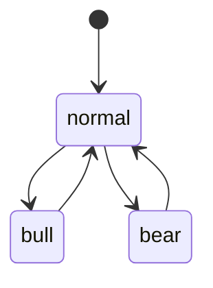

# 红利ETF网格状态机管理

## 定位

状态机约束网格和趋势持有模式的合法转换。**市场判断由 Agent 完成**，不是由固定阈值脚本完成；脚本只校验提案、保存迁移前后状态与真实仓位快照。

```text
事实采集 → Agent 判断 → 状态提案 → 迁移校验 → 人工执行指令
```

## 三态定义

| 状态 | 模式 | 红利 | 双创 |
|---|---|---|---|
| `normal` | 双网格 | 买入、卖出均启用 | 买入、卖出均启用 |
| `bull` | 科技趋势持有 | 清仓并停止买入 | 停止卖出，人工管理趋势仓位 |
| `bear` | 防御趋势持有 | 停止卖出，人工管理趋势仓位 | 清仓并停止买入 |

状态行为的机器可读定义以 `params/state_machine.json` 为准。

## 合法迁移



`bull → bear` 与 `bear → bull` 禁止直接转换，必须先回到 `normal`。当关键证据冲突时，Agent 应保持当前状态。

## Agent 决策协议

Agent 读取前序状态、当日风险事实、板块事实及文本资料后，写入：

```text
交易/过程资料/{date}/红利ETF网格/transition_proposal.json
```

最小结构：

```json
{
  "date": "YYYY-MM-DD",
  "system_id": "div_etf_grid_trade",
  "from_state": "normal",
  "to_state": "bull",
  "decision": "transition",
  "confidence": "high",
  "evidence_summary": ["投顾研判", "板块与行情事实"],
  "conflict_resolution": "无关键冲突",
  "decided_by": "agent"
}
```

- `decision` 只能是 `keep` 或 `transition`；
- `keep` 时 `to_state` 必须等于 `from_state`；
- 提案保存可复盘的依据摘要，不保存 Agent 原始思维链；
- 提案无法解释或证据关键冲突时，默认 `keep`。

## 迁移校验与审计

```bash
apply_state_transition.py \
  --date {date} \
  --proposal {transition_proposal.json} \
  --positions {positions.json}
```

脚本执行以下确定性工作：

1. 读取最近有效 `state_after.json`；
2. 校验提案的 `from_state`；
3. 校验状态迁移是否合法；
4. 将真实持仓保存为 `state_before.json`；
5. 写入 `state_after.json`；
6. 在进入趋势状态时保留恢复网格所需的仓位快照。

脚本不重新判断牛熊，也不修改账户或条件单。

## 切换执行指令

```bash
build_switch_instruction.py --date {date}
```

该脚本读取已固化的迁移结果与真实仓位快照，输出 `switch_instruction.json`。它不猜测迁移方向、不使用默认仓位、不硬编码价格，且不直接下单。

人工执行后，应在交易计划和交易复盘中记录成交价格、成交份额、未执行原因及条件单变更。